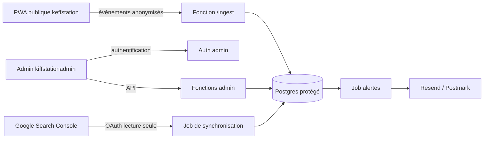

# Architecture — Administration Keffstation

## 1. Objectif

Le tableau d'administration est réservé au propriétaire de Keffstation. Il doit afficher :

- les visites ;
- les clics par lien, bouton, onglet et menu ;
- les formulaires (démarrage, envoi, succès, erreurs) ;
- les recherches internes à Keffstation ;
- les indicateurs de fiabilité du projet ;
- les données Google Search Console, dans un espace séparé.

Le graphique principal est une **montagne 3D sur une base carrée**, avec un **sommet central représentant la fiabilité**. Les périodes sélectionnables sont : **7, 10, 30 jours ou dates personnalisées**.

Le tableau doit rester lisible et léger sur un téléphone Android.

## 2. Séparation des dépôts

| Dépôt | Visibilité | Rôle |
|---|---|---|
| `keffstation` | public | PWA vitrine, pages publiques, collecte d'événements |
| `kiffstationadmin` | privé | Tableau de bord, fonctions d'administration, aucune donnée publique |

Les deux dépôts ne sont **pas** reliés par SSH, par un sous-module ou par un jeton partagé. La connexion se fait au niveau des données :

## 3. Stack recommandée

| Couche | Choix recommandé | Pourquoi |
|---|---|---|
| Frontend admin | HTML/CSS/JS vanilla + Canvas 2D | Léger sur Android, pas de framework ni de WebGL lourd |
| Base de données | Supabase (Postgres + Auth + RLS) | RLS native, Auth, fonctions serveur, coût maîtrisé |
| API | Supabase Edge Functions | La clé `service_role` reste côté serveur |
| Hébergement | Cloudflare Pages ou Vercel | Déploiement simple, variables d'environnement protégées |
| E-mails | Resend ou Postmark | Domaine vérifié, SPF/DKIM/DMARC, envoi transactionnel |
| Monitoring | Better Stack / UptimeRobot + Sentry | Disponibilité et erreurs, avec filtrage des données personnelles |
| Paiements | PayPal Sandbox | Tests de refus sans vraie commande |
| Recherche Google | OAuth Search Console en lecture seule | Données différées, jamais mélangées aux recherches internes |

Alternative possible : Cloudflare Workers + D1. Supabase reste recommandé pour la combinaison Auth + RLS + Postgres.

## 4. Modèle de données

### 4.1 Tables principales

**`analytics_events`** — événements bruts, sans données personnelles.

| Colonne | Type | Note |
|---|---|---|
| `id` | uuid | clé primaire |
| `occurred_at` | timestamptz | stocké en UTC |
| `session_id` | text | identifiant de session haché, pas d'IP brute |
| `event_type` | text | `page_view`, `click`, `tab_view`, `menu_open`, `form_start`, `form_submit`, `form_error`, `search`, `payment_attempt`, `payment_result`, `error` |
| `element_type` | text | `link`, `button`, `tab`, `menu`, `form`, `search`, `payment` |
| `element_id` | text | identifiant technique stable |
| `element_label` | text | libellé court, sans donnée personnelle |
| `path` | text | chemin de page, sans paramètres sensibles |
| `metadata` | jsonb | données techniques uniquement |
| `device_type` | text | mobile, tablette, desktop |
| `referrer_domain` | text | domaine seulement, pas l'URL complète |
| `country_code` | text | pays approximatif, optionnel |

**`sessions`** — sessions agrégées.

| Colonne | Type | Note |
|---|---|---|
| `id` | uuid | clé primaire |
| `started_at` | timestamptz | début |
| `ended_at` | timestamptz | fin |
| `device_type` | text | mobile, tablette, desktop |
| `landing_path` | text | page d'entrée |
| `referrer_domain` | text | domaine |
| `is_bot` | boolean | filtrage robots |

**`form_events`** — métriques de formulaires, sans valeurs saisies.

| Colonne | Type | Note |
|---|---|---|
| `id` | uuid | clé primaire |
| `form_id` | text | identifiant du formulaire |
| `event_type` | text | `start`, `submit`, `success`, `error` |
| `error_code` | text | code technique, pas de message contenant des données personnelles |
| `occurred_at` | timestamptz | horodatage |

**`search_events`** — recherches internes à Keffstation.

| Colonne | Type | Note |
|---|---|---|
| `id` | uuid | clé primaire |
| `query` | text | requête interne, nettoyée |
| `results_count` | integer | nombre de résultats |
| `clicked_result_id` | text | résultat cliqué, optionnel |
| `occurred_at` | timestamptz | horodatage |

**`gsc_queries`** — données Google Search Console, séparées.

| Colonne | Type | Note |
|---|---|---|
| `date` | date | date de la donnée |
| `query` | text | requête Google |
| `clicks` | integer | clics |
| `impressions` | integer | impressions |
| `ctr` | numeric | taux de clic |
| `position` | numeric | position moyenne |
| `fetched_at` | timestamptz | date de récupération |
| `is_partial` | boolean | données incomplètes ou masquées |

**`reliability_snapshots`** — indicateurs de fiabilité.

| Colonne | Type | Note |
|---|---|---|
| `snapshot_at` | timestamptz | horodatage |
| `uptime_pct` | numeric | disponibilité |
| `error_rate` | numeric | taux d'erreur |
| `form_success_rate` | numeric | formulaires réussis / démarrés |
| `payment_success_rate` | numeric | paiements réussis / tentés |
| `data_freshness` | numeric | fraîcheur des données |
| `score` | numeric | score composite 0–100 |

**`alerts`** — alertes envoyées.

| Colonne | Type | Note |
|---|---|---|
| `id` | uuid | clé primaire |
| `alert_type` | text | type d'alerte |
| `summary` | text | résumé sans données personnelles |
| `secure_link` | text | lien vers l'admin, authentification requise |
| `created_at` | timestamptz | création |
| `sent_at` | timestamptz | envoi |

**`admin_audit_log`** — journal des actions admin.

| Colonne | Type | Note |
|---|---|---|
| `id` | uuid | clé primaire |
| `actor` | text | identifiant admin |
| `action` | text | action effectuée |
| `ip_hash` | text | IP hachée, jamais brute |
| `user_agent` | text | agent utilisateur tronqué |
| `created_at` | timestamptz | horodatage |

### 4.2 Règles d'accès (RLS)

- RLS activé sur toutes les tables.
- Par défaut : **aucun accès**.
- La PWA publique utilise une clé `anon` limitée à l'**insertion** d'événements, via une fonction `/ingest` avec limitation de débit et filtrage des robots.
- Aucun `SELECT` public sur les événements, les formulaires ou les recherches.
- L'administration lit des **vues agrégées** via des fonctions serveur authentifiées.
- La clé `service_role` n'est **jamais** exposée au navigateur. Elle reste dans les variables d'environnement de l'hébergeur.
- Les soumissions complètes de formulaires, si elles doivent être stockées, vont dans une table séparée, chiffrée, accessible uniquement côté serveur, avec une durée de conservation limitée.
- Les e-mails d'alerte ne contiennent jamais les données complètes des formulaires.

## 5. Authentification admin

### 5.1 Décision actuelle

Le propriétaire a demandé de **reporter la double vérification** et de démarrer avec une seule authentification. C'est accepté pour le prototype et la phase de développement, mais **ce n'est pas la configuration de production**.

### 5.2 Phase 1 — développement

- Un seul compte admin, pas d'inscription publique.
- Mot de passe long et unique, stocké dans le gestionnaire de mots de passe.
- Limitation des tentatives, verrouillage temporaire.
- Session courte (30 minutes), cookie `HttpOnly`, `Secure`, `SameSite=Strict`.
- Protection CSRF.
- Journal d'audit.
- Aucun secret dans le code du navigateur.

### 5.3 Phase 2 — avant mise en ligne

- Double vérification obligatoire : TOTP ou passkey.
- Codes de secours conservés hors ligne.
- Pas de 2FA par SMS seule.
- Rotation des secrets.
- Test de récupération de compte.

Une seule authentification par mot de passe reste vulnérable au vol de mot de passe, au phishing et au credential stuffing. Le tableau ne doit pas être exposé publiquement avec des données réelles avant la phase 2.

## 6. Collecte des événements

- La PWA publique envoie les événements à `/ingest` avec `navigator.sendBeacon` ou `fetch`.
- Les événements sont regroupés par lots pour limiter les requêtes.
- Les identifiants de session sont générés côté client puis hachés côté serveur.
- Pas d'IP brute, pas d'URL complète avec paramètres sensibles, pas de contenu de formulaire.
- Filtrage des robots et limitation de débit.
- Les clics sont identifiés par `element_type` + `element_id` + `element_label`.
- Les onglets et menus sont suivis comme des événements distincts.
- Les recherches internes sont envoyées à `/ingest` avec `event_type=search`, jamais mélangées aux données Google.

## 7. Métriques et fiabilité

### 7.1 Indicateurs

- **Visites** : sessions, pages vues, visiteurs uniques approximatifs, taux de rebond.
- **Clics** : par type (lien, bouton, onglet, menu), par élément, par page.
- **Formulaires** : démarrages, envois, taux de succès, erreurs par formulaire.
- **Recherches internes** : requêtes, résultats, taux de zéro résultat, clics sur résultats.
- **Google Search Console** : clics, impressions, CTR, position moyenne, avec badge « différé » et mention des requêtes masquées.
- **Fiabilité** : disponibilité, taux d'erreur, succès des formulaires, succès des paiements, fraîcheur des données.

### 7.2 Score de fiabilité

Le sommet central représente un score composite de 0 à 100 :

| Composante | Poids |
|---|---:|
| Disponibilité | 30 % |
| Taux de succès des formulaires | 20 % |
| Taux de succès des paiements | 20 % |
| Taux d'erreur (inversé) | 15 % |
| Fraîcheur des données | 15 % |

Règles :

- chaque composante est normalisée sur 0–100 ;
- le score est la moyenne pondérée ;
- si l'échantillon est trop petit, afficher « données insuffisantes » au lieu d'un score trompeur ;
- afficher les composantes et la période, pas seulement le chiffre central ;
- comparer à la période précédente avec prudence.

## 8. Graphique montagne 3D

### 8.1 Principe

- Base carrée, vue isométrique.
- Sommet central : score de fiabilité.
- Quatre crêtes : visites, clics, formulaires, recherches.
- Le relief est une synthèse de la période sélectionnée, pas une animation permanente.
- Le sélecteur de période change la fenêtre d'agrégation et redessine la montagne.

### 8.2 Rendu

- **Canvas 2D** avec projection isométrique, pas de Three.js ni de Plotly.
- Grille de 24 × 24 à 32 × 32 cellules.
- Couleurs : bleu (faible) → vert (moyen) → or (élevé).
- Ombrage directionnel simple pour donner du relief.
- Lignes de grille discrètes.
- Marqueur central avec libellé « Fiabilité ».
- Libellés autour de la base : Visites, Clics, Formulaires, Recherches.
- Légende et tableau de repli accessible.

### 8.3 Lisibilité sur Android

- Hauteur du graphique : 280–340 px sur téléphone.
- `devicePixelRatio` plafonné à 2.
- Pas d'animation continue, pas de flou, pas d'ombre coûteuse.
- Redessin uniquement au changement de période, au redimensionnement ou au toucher.
- Zones tactiles de 44 px minimum.
- Respect de `prefers-reduced-motion`.
- Tableau de données masqué visuellement mais accessible aux lecteurs d'écran.

### 8.4 Périodes

- 7 jours : agrégation quotidienne.
- 10 jours : agrégation quotidienne.
- 30 jours : agrégation quotidienne.
- Dates personnalisées : maximum 90 jours, validation début ≤ fin.
- Stockage en UTC, affichage dans le fuseau local (Europe/Paris par défaut).
- Comparaison avec la période précédente de même durée.

## 9. E-mails d'alerte

Les alertes sont déclenchées par :

- chute de disponibilité ;
- pic d'erreurs de formulaire ;
- pic d'échecs de paiement ;
- baisse brutale du score de fiabilité ;
- trafic anormal.

Chaque e-mail contient :

- un résumé (type, période, nombre, gravité) ;
- un lien sécurisé vers le tableau de bord, protégé par authentification ;
- aucune donnée personnelle complète ;
- aucun secret, aucune pièce jointe sensible.

Bonnes pratiques :

- SPF, DKIM et DMARC configurés ;
- limitation et déduplication des alertes ;
- clé API d'envoi limitée à l'envoi ;
- pas de données de formulaire dans l'e-mail.

## 10. Google Search Console

- Connexion OAuth en **lecture seule**.
- Synchronisation côté serveur, pas dans le navigateur.
- Table `gsc_queries` séparée de `search_events`.
- Badge « Données différées de 2 à 3 jours ».
- Mention « Certaines requêtes sont masquées par Google ».
- Aucune comparaison directe avec les recherches internes.
- Deux onglets distincts dans l'interface : « Recherches internes » et « Google Search Console ».

## 11. PayPal Sandbox

- Compte PayPal Developer + comptes Sandbox business/personal.
- Cartes de test : refus, fonds insuffisants, carte expirée.
- Aucune vraie commande pendant les tests.
- Identifiants Sandbox uniquement dans les variables d'environnement serveur.
- Webhooks Sandbox séparés, signature vérifiée, idempotence.
- Les tests de refus ne doivent jamais créer de commande réelle.
- Passage en production plus tard, avec identifiants API à privilège minimal.

## 12. Accès et permissions minimales

| Service | Accès nécessaire | Permission minimale |
|---|---|---|
| GitHub | code | dépôt privé, aucun secret commité |
| Supabase | base + auth | `service_role` côté serveur uniquement ; `anon` en insertion limitée |
| Hébergement | frontend + fonctions | variables d'environnement, aucun secret dans le dépôt |
| Resend/Postmark | alertes | clé d'envoi uniquement |
| Google Search Console | lecture | OAuth lecture seule |
| PayPal | tests | Sandbox uniquement |
| Monitoring | supervision | lecture seule |
| Gestionnaire de mots de passe | secrets | coffre chiffré, 2FA |

Aucun serveur SSH/SSHD n'est nécessaire. Les déploiements passent par GitHub Actions ou par l'interface de l'hébergeur. Aucune clé SSH dans le dépôt.

## 13. Points à valider avant le code de production

1. Supabase ou Cloudflare D1 ?
2. Frontend vanilla ou framework léger ?
3. Nom de domaine de l'admin (par exemple `admin.keffstation.com`) ?
4. Fuseau horaire d'affichage ?
5. Durée de conservation des événements bruts ?
6. Date d'activation de la 2FA avant mise en ligne ?
7. Quelles données de formulaire sont réellement nécessaires côté admin ?

Tant que ces points ne sont pas validés, le prototype reste une maquette avec des données fictives.
